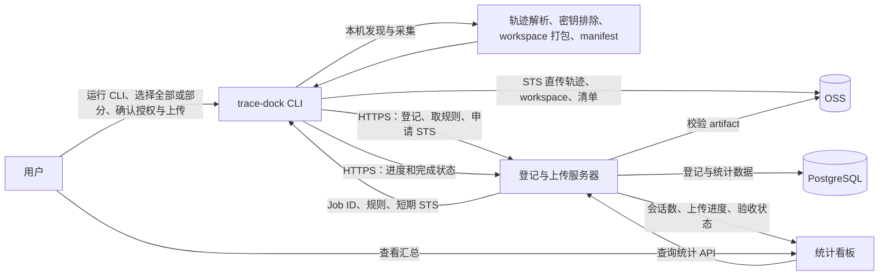
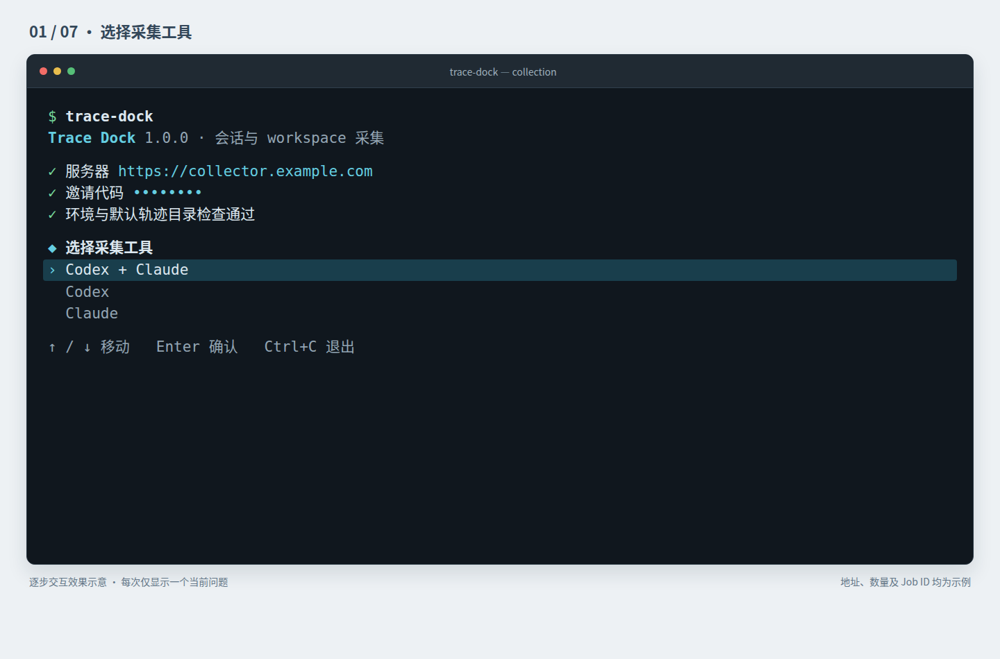
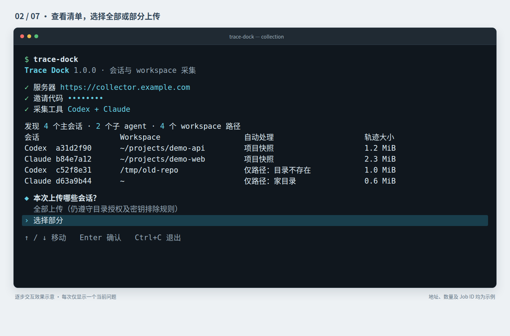
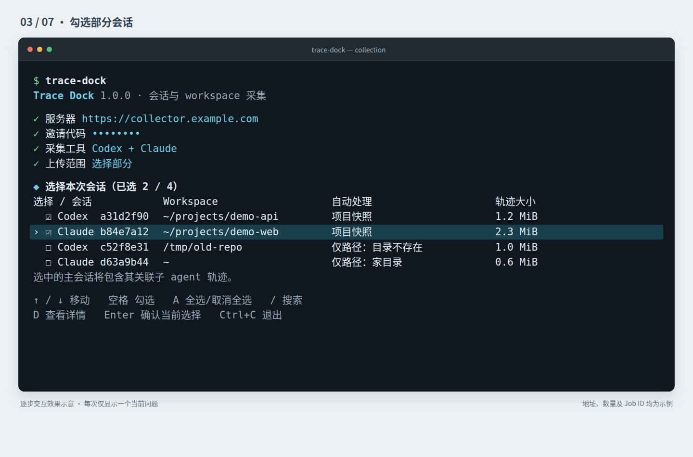
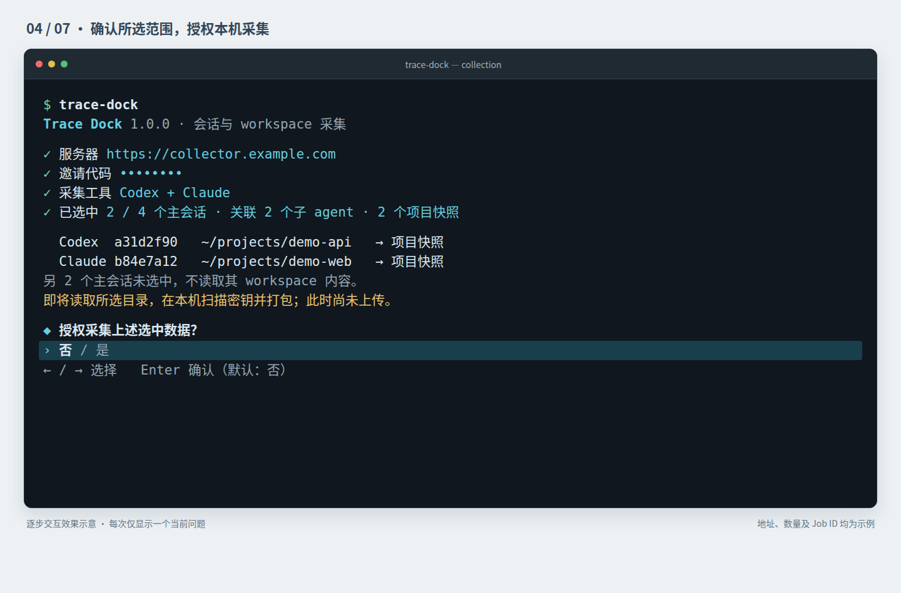
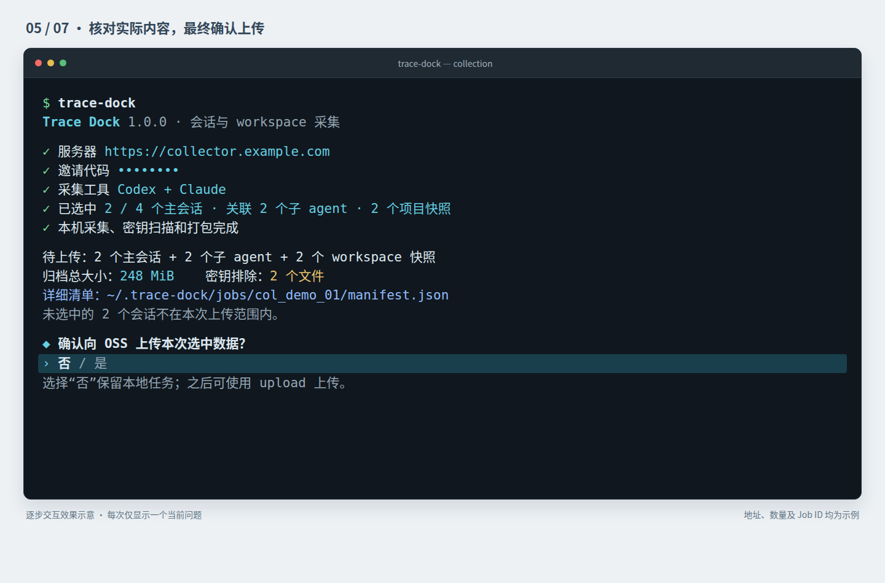
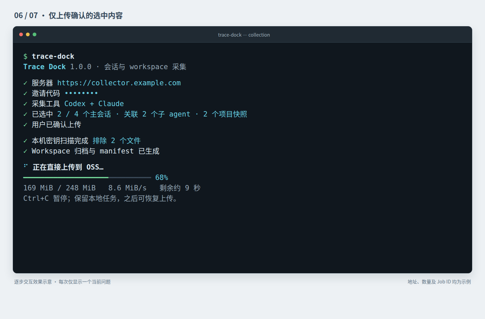
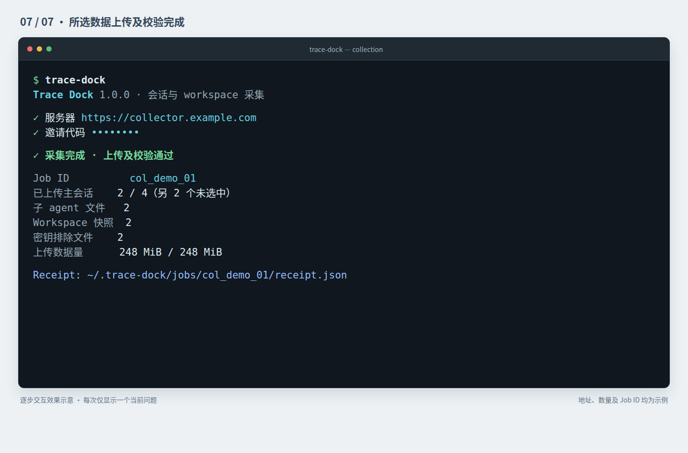
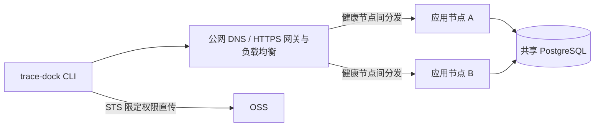
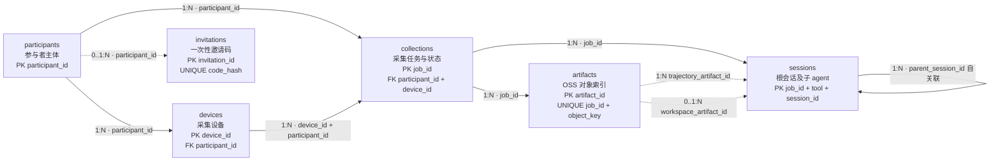

# 存量 workspace 与轨迹回收 CLI 技术方案

**状态**：提案  
**日期**：2026-11-11  
**关联文档**：[RFC-01-存量workspace与轨迹回收.md](./RFC-01-存量workspace与轨迹回收.md)、[RFC-01_1000人5万份_资源采购测算.md](./RFC-01_1000人5万份_资源采购测算.md)

## 1. 文档目的

本文将 RFC-01 的采集约束落实为可开发、发布和验收的命令行产品，暂命名为 `trace-dock`。用户安装 CLI 后直接在命令行输入 `trace-dock` 启动交互式采集，在本机登记并采集 Codex / Claude Code 的历史 workspace 和轨迹，再将元数据及文件上传到回收服务和对象存储。

RFC-01 是 Codex/Claude 解析、workspace 分类、密钥排除、大文件出列、会话去重及有效性判定的规范来源；本文和 MVP 文档只定义实现与功能范围，不得自行放宽这些数据处理规则。发现新 schema 或调整规则时，先修订 RFC 和对应版本化规则，再更新实现文档。

[MVP 技术方案](./CLI-MVP-技术方案.md) 只实现本文 4.1 的采集上传闭环，使用预登记邮箱/token 和两张表，暂不实现混合工具采集、额外子命令、看板和管理界面。数据处理和验收仍执行相同规则；本文的扩展能力不构成 MVP 可以省略密钥扫描、子 agent、分级、去重或验收的依据。

安装并启动：

```bash
npm install --global @trace-dock/cli
trace-dock
```

CLI 检查环境、登记任务并发现候选数据，列出会话及关联 workspace，让用户选择全部或部分内容并授权本机采集；随后完成密钥排除、生成清单和归档，展示实际上传范围与体积，用户确认后断点续传，最后输出采集编号及校验结果。

目标是支持 Linux、macOS、Windows；中断不修改源文件，恢复时不重复上传已校验对象，并产出下游可读取、可在异机验证的 manifest。

## 2. 目标与非目标

### 2.1 目标

- 安装后通过 `trace-dock` 启动逐步问答式交互；同时支持显式子命令和非交互运行。
- 自动发现 Codex、Claude 主会话及 Claude 子 agent 轨迹。
- 按字段形状识别 Codex 新旧 schema；未知格式跳过并记录原因，不猜测解析。
- 登记先于采集，记录会话结束时间、采集时间及时间差。
- 仅读明确范围内的轨迹，不整体打包 `~/.claude` / `~/.codex`，不碰 Codex SQLite/WAL/SHM。
- 在源机器扫描密钥，命中文件整体排除并登记，不原地替换。
- 根据 cwd 类型选择 workspace 快照或仅记录路径。
- 列出发现的会话和关联 workspace，支持全选、部分勾选；只采集并上传用户确认的范围。
- 统一 ID、SHA-256、对象键，支持幂等、断点续传和去重。
- 输出按人和工具统计，并支持异机验证文件树和可逆性。

### 2.2 非目标

- 不承诺从缺少起始基线的 Codex diff 还原 workspace；此类会话只归档。
- 不修改或删除用户源目录和轨迹。
- 不上传 Claude credentials、shell snapshots、memories、Codex SQLite/WAL/SHM。
- 首版不提供题库生成器、数据标注工作台或通用云端浏览器。
- 不以体积阈值单独决定大文件是否从快照剔除。

## 3. 方案摘要

### 3.1 入口与核心实现

产品分两层：

1. **npm CLI 分发包**：发布 `@trace-dock/cli`，全局安装后提供 `trace-dock` 命令。安装器识别平台/架构，下载核心二进制，校验 SHA-256 后安装到 npm 包目录。
2. **CLI 核心**：使用 Go 实现发现、JSONL 解析、路径处理、哈希、归档、并发、断点续传和跨平台文件操作，核心不依赖 Node.js。

CLI 使用标准库和纯 Go 依赖，设置 `CGO_ENABLED=0`，在一台构建机交叉编译各目标平台产物；参与者不需要安装 Go 或 Python。服务端使用 Python 3.12+ 实现 HTTPS API，通过版本化 JSON 契约与 CLI 交互。

npm 分发包只负责安装和启动核心二进制，不保存用户数据、不扫描采集目录。也可直接安装对应平台的发行版二进制；两种发行方式使用相同的 SHA-256 校验清单。

npm 安装方式要求本机已安装 Node.js 和 npm；不具备该运行环境时使用对应平台的独立二进制。

### 3.2 组件和数据流



不支持 Mermaid 渲染时，可查看下面的文本流程图：

```text
[用户] --运行 CLI / 确认授权--> [trace-dock CLI]
                                      |
                 HTTPS 登记 / 获取规则 / 申请 STS
                                      v
                              [登记与上传服务器] <--> [PostgreSQL]
                                      |
                    返回 Job ID / 规则 / 短期 STS
                                      v
                              [trace-dock CLI]
                                /           \
             STS 直传轨迹、workspace       HTTPS 上报进度/
                和 manifest                 完成状态
                    v                           |
                  [OSS] <---服务器校验对象------+
                                                |
                                                v
                                      [统计看板] <---查看汇总--- [用户]
                                         |
                                   请求统计 API
                                         v
                                  [登记与上传服务器]
```

```text
1. 用户运行 trace-dock，CLI 登记任务并在本机发现会话及关联 workspace。
2. 用户查看清单，选择全部或部分会话，并授权本机采集。
3. CLI 仅处理选中项，执行密钥排除、workspace 分级和打包，生成 manifest。
4. 用户核对实际上传体积和排除清单并确认后，CLI 申请短期 STS，直传选中内容至 OSS。
5. CLI 向服务器报告进度和完成状态；服务器校验 OSS 对象并保存统计元数据。
6. 看板通过服务器统计 API 展示参与人数、会话数量、上传进度和验收状态。
```

待上传内容必须先在源机器完成扫描和 SHA-256 计算。服务端不通过 SSH、共享目录或远程执行访问用户机器。

## 4. 用户体验与命令

### 4.1 默认交互

CLI 按顺序逐项提问，每次只展开当前问题。用户按 Enter 确认后，该问题收起为一行已选结果，随后显示下一项。workspace 分级来自 RFC-01“workspace 按 cwd 性质分级采集”，由 CLI 自动执行并在清单中解释，不作为用户必须理解和选择的“workspace 策略”。以下七张图展示选择部分会话上传的连续过程，地址、数量及 Job ID 均为示例值。

**① 选择采集工具**

首次运行先核对预填的默认服务器地址（可直接确认，也可修改），再输入邀请代码；MVP 中邀请代码即本人预登记 token。连接信息确认后，展开工具选择；当前只响应工具选项。选择工具后自动登记任务并取得规则，再进入发现阶段，不增加额外问答。



**② 发现数据并列出清单，选择全部或部分上传**

列出会话和关联 workspace，显示工具、会话 ID、cwd 和 workspace 处理结果；详情中展示完整路径、会话结束时间、任务摘要（可取得时）、轨迹大小和子 agent 数量。清单按结束时间倒序分页，支持搜索。选择“全部上传”时选中全部符合采集条件的条目并跳到范围确认；选择“选择部分”时进入多选清单。全选跨全部页生效，确认前显示总数；全选也必须遵守本机密钥排除和目录授权规则。



**③ 勾选部分会话**

方向键移动、空格切换、A 全选或取消全选、斜杠搜索、D 查看当前条目的完整路径与元数据、Enter 确认。以根会话为最小选择单位，关联子 agent 自动包含；同一 workspace 关联多个选中会话时，共用一份采集时快照。零选中时不能继续，选择部分后的其余条目不读取 workspace 内容、不打包、不上传。



**④ 确认选中范围，授权本机采集**

显示选中/未选中主会话数量、关联子 agent 数量、去重后的 workspace 目录及处理结果，再确认是否授权本机读取和打包，默认选择“否”。确认前不读取 workspace 文件内容。cwd 缺失或不适合快照时仍可选择其轨迹，清单明确注明 workspace 仅记路径及原因。



**⑤ 扫描打包后，最终确认上传**

完成本机密钥扫描后，显示实际待上传主会话、子 agent、workspace 快照数量、归档体积及排除文件数，并提供本地详细清单路径。用户确认“是”后才申请 STS 并传输内容；选择“否”则保留本地导出任务，稍后可 upload。该确认不会自动加入未选中的会话。



**⑥ 上传选中内容**

只显示本次选中范围的上传进度；中断后可以恢复，恢复时沿用已确认的清单，不自动扩大范围。



**⑦ 校验完成后，显示结果**

OSS 对象校验通过后，显示任务编号、归档数量、排除数量、上传量和 receipt 路径，随后退出。



发现预览阶段会在本机读取轨迹 JSONL，以提取 cwd 和会话元数据；允许查看分类所需目录元数据，但不读取 workspace 文件内容、不执行密钥扫描、不上传文件。只有用户确认授权后，CLI 才登记所选会话的源路径和时间，再读取所选 workspace 文件、执行密钥扫描并生成归档。完成后显示 Job ID、发现/采集/归档/无效数、排除数、上传量、manifest 摘要和 receipt 路径。

### 4.2 命令与参数

```bash
npm install --global @trace-dock/cli
trace-dock
trace-dock collect
trace-dock inspect
trace-dock verify <job-id>
trace-dock upload <job-id>
trace-dock resume <job-id>
trace-dock doctor
```

安装完成后直接运行 `trace-dock` 进入默认交互流程；传入子命令时执行对应操作。无法使用 npm 的环境可从发布页下载对应平台的独立二进制，并按发布清单校验 SHA-256。

| 命令 | 行为 |
| --- | --- |
| `collect` | 发现并列出清单，选择全部或部分，授权采集并确认上传 |
| `inspect` | 解析轨迹元数据并预览，不读取 workspace 文件内容、不打包、不上传 |
| `verify` | 检查本地 staging、manifest 摘要和归档完整性 |
| `upload` | 上传已导出任务，支持恢复 |
| `resume` | 恢复未完成的采集或上传 |
| `doctor` | 检查权限、磁盘、网络和默认路径 |

主要参数：`--server URL`、`--invitation-code CODE`、`--tool codex,claude`、`--all`、`--selection FILE`、`--output DIR`、`--no-upload`、`--dry-run`、`--yes`、`--non-interactive`、`--max-parallel N`、`--config FILE`、`--log-level LEVEL`。邀请代码不落盘、不进日志；所有日志级别均须脱敏。

`--all` 与 `--selection FILE` 互斥：前者显式选择全部允许采集的会话，后者按 JSON 清单中的工具和根会话 ID 精确选择部分会话，不能因共享 cwd 自动扩展到其他会话。交互模式不传这两个参数时，进入清单选择步骤。

无 TTY 模式下，必须提供工具、明确选择范围（`--all` 或 `--selection FILE`）和 `--yes`；在线上传还须提供服务器和邀请凭证，离线 `--no-upload` 不要求连接服务器。缺项时报错，不把默认全选当作同意。`--yes` 仅确认已指定范围及其规则处理结果，不扩大范围或绕过密钥排除。

### 4.3 本地目录与配置

| 用途 | 默认路径 | 覆盖方式 |
| --- | --- | --- |
| Codex | `~/.codex/sessions` | `TRACE_DOCK_CODEX_HOME` |
| Claude | `~/.claude/projects` | `TRACE_DOCK_CLAUDE_HOME` |
| CLI 任务目录 | Linux/macOS `~/.trace-dock`；Windows `%LOCALAPPDATA%/trace-dock` | `TRACE_DOCK_HOME` |

配置文件为 `$TRACE_DOCK_HOME/config.json`，仅保存服务器地址和默认策略。优先级：命令行、环境变量、配置文件、内置默认值。

```text
<TRACE_DOCK_HOME>/
  config.json
  jobs/<job-id>/
    discovery.json
    selection.json
    consent.json
    manifest.json
    exclusions.jsonl
    large-files/<workspace-artifact-id>.jsonl
    staging/
    upload-state.json
    receipt.json
    logs.jsonl
```

Unix 目录权限 0700、文件 0600；Windows 使用当前用户 ACL。退出时保留任务以支持恢复，不自动清理；删除必须通过显式 purge 命令。

## 5. 发现与解析架构

Codex 和 Claude 使用独立原始解析器，只共享归一化接口：

```text
discover(root) -> []SessionCandidate
inspect(candidate) -> SessionInspection
collect(candidate, policy, sink) -> CollectedSession
reversibility(session) -> ReversibilityReport
```

解析不得修改源文件；单文件错误不能中止整个任务；未知 schema 产生 `unsupported_schema`。原始路径、规范化路径、session ID 和 root session ID 分开保存，不把工具原生证据压平到丢失语义的通用字段。

### 5.1 Codex

发现范围：`~/.codex/sessions/YYYY/MM/DD/rollout-*.jsonl`

| 版本 | 识别形状 | 工具调用 |
| --- | --- | --- |
| 旧版 | 顶层 `type == "response_item"` | `apply_patch`、`exec_command` |
| 新版 | 顶层 `payload.type` 是 `item_completed` / `custom_tool_call` | `exec`；可能有 `ordinal`、`thread_name` |

混合形状标记 `mixed_schema`，不视作可解析；未知格式不上传原文并记录跳过原因。Codex 主要只有 unified diff，缺少基线时设置 `reversibility=not_reconstructable`、`archive_eligibility=archive_only`。出现 `compacted` 时设置 `has_compaction=true` 并标记只归档。

### 5.2 Claude

从 `~/.claude/projects` 开始递归遍历并筛选所有 JSONL 文件，不依赖 shell 的 `**` glob 语义；包括主轨迹和 `<session-id>/subagents/agent-*.jsonl`。cwd 必须来自 JSONL 事件字段，禁止从 projects 编码目录名还原。

- 主轨迹文件名作为 session ID；符合 `<session-id>/subagents/agent-*.jsonl` 结构时，从父目录取得 parent session ID，并记录 agent ID；事件中的显式关联字段优先。
- root session ID 只从事件字段或明确的父子目录结构取得；无证据不猜测归并。
- resume/fork 多份按事件数、文件大小、结束时间选择最长版本；其他 ID 写入 aliases。
- 可逆性判定必须包含递归子 agent；只解析主轨迹不能标为最终可逆。Edit 只有在 old/new 两侧证据完整时才可逆；Write 若覆盖已有文件但轨迹没有旧内容，不能仅凭 Write 的新 content 判为可逆。会修改文件的 shell 命令（如 sed -i、重定向、cp、git checkout）若影响无法从轨迹证明或重放，判为 unknown / archive_only。最终可逆结论必须由异机 verifier 通过文件树比对确认。

### 5.3 路径规范化

保存 cwd_raw、cwd_normalized、cwd_platform、cwd_exists_at_collect。Windows 统一分隔符、盘符大小写并按大小写不敏感比较；Linux/macOS 不折叠大小写。规范化仅用于比较和分类，不覆盖原始路径。

## 6. workspace 与大文件策略

### 6.1 cwd 分类

| 类型 | 判定 | 行为 |
| --- | --- | --- |
| project | 单一正常项目目录 | 默认快照 |
| parent | 包含多个独立项目仓库的上层目录 | 仅记录路径，不存内容 |
| home | cwd 等于用户 home | 仅记录路径，不存内容 |
| artifact | 训练日志、checkpoint、数据集等产物目录 | 仅记录路径，标记非代码会话 |
| missing | 采集时 cwd 不存在 | 仅记录路径；轨迹仍按选择范围处理 |
| unknown | 无法安全判断 | 默认仅记录路径，不存内容 |

path_only 保留 cwd、存在性、mtime、类型和分类理由；只读取分类必需的目录元数据，不读取文件内容，不扫描或打包该目录。

parent 按“多个独立项目的上层目录”识别；不能仅凭 `.git` 数量将单一项目中的子模块误判为 parent。无法安全判断时归为 unknown。

此分级规则自动应用于用户选中的会话，不再提供默认交互中的“workspace 策略”选择。会话清单必须显示处理结果，例如“项目快照”“仅路径：家目录”“仅路径：目录不存在”；用户通过全选/多选决定本次采集哪些会话。选择全部不会把 home、parent、artifact、missing 或未授权的跨人目录升级成快照。

### 6.2 项目快照

- 不跟随目录外符号链接；只记录链接本身及目标字符串。
- 归档路径为相对路径，拒绝绝对路径、..、NUL 和规范化后的重复路径。
- 保留普通文件、目录、符号链接和必要权限。
- .git/ 目录及 pack 文件不因大文件规则出列，不列入大文件清单；密钥命中仍按整文件排除处理。
- 密钥命中文件及命中大文件黑名单/阈值的文件从快照出列，分别写入排除清单和大文件清单；不修改源文件。权限不足、特殊设备和循环链接写入排除清单。
- 使用确定性 tar.zst：相对路径排序，mtime、uid、gid 等非必要字段归一化。

### 6.3 大文件清单

大文件清单记录从 workspace 快照中出列的文件，供下游按 remote_path 查找或重新获取。每份清单与一个 workspace artifact 关联，关联关系由 manifest 和对象键表达，不在清单行重复存 session ID。文件是否出列严格按 RFC-01 的三层规则判断，配置与 RFC-02 共用同一份版本化规则：

1. **白名单优先**：`.git/` 内部一律保留在 workspace 快照，不放入大文件清单；分析结果等需保留的文件类型也可进入规则白名单。
2. **黑名单**：按目录和后缀识别模型、权重、数据集和压缩包，例如 *.safetensors、*.pt、*.ckpt、*.onnx、*.gguf、*.parquet、*.zip；命中后从 workspace 快照出列，并记入大文件清单。
3. **体积兜底**：仅对未命中前两层的文件应用规则配置中的阈值；命中后从快照出列并记入清单。阈值由版本化规则配置，不在 CLI 中写死。

大文件白名单仅豁免大文件出列，不能绕过密钥扫描。通过密钥扫描且命中白名单的文件留在快照且不出现在大文件清单；命中黑名单或兜底阈值的文件从快照出列，但源文件不删除、不移动、不修改。RFC-01 规定的大文件清单每条只包含 `relative_path` 和 `remote_path`。远端路径优先从轨迹中的 wget、curl、aws s3 cp、scp 等命令提取；否则用 `<machine_name>:<absolute_path>` 表示带机器名的本机绝对路径；无法确定时填 null 并统计，不猜测。规则版本记录在 manifest/任务规则元数据，不扩展清单字段。

## 7. 本机密钥扫描

扫描范围包括待上传轨迹 JSONL/工具输出、将进入快照的普通文件、文件名/路径规则、环境文件/凭据/私钥和常见 token 格式。扫描发生在源机器；secret 值不得写入日志、manifest、错误消息或 API 请求，日志仅记录相对路径、文件哈希和规则 ID。

规则至少覆盖私钥头、JWT、云 access key、API key、数据库 URL 密码、.env/.npmrc/.pypirc、云凭据、SSH 私钥、轨迹输出中的密码参数/Bearer token/高熵长串。

命中后整个文件排除，不修改源文件；exclusions.jsonl 记录路径、SHA-256、规则 ID、scope 和 action。若唯一轨迹被排除，保留会话元数据并标记 partial/archive_only。二进制按文件名、扩展名、MIME 判定，高风险默认排除；扫描器异常时 fail-closed。

## 8. Job、manifest 与去重

### 8.1 状态机

```text
created -> registered -> discovered -> selecting -> selected
        -> awaiting_consent -> collecting -> awaiting_upload_confirmation
        -> ready_to_upload -> uploading -> verifying -> completed
```

任意阶段可进入 failed/cancelled；采集或上传可恢复错误进入 resumable。状态同时写本地和服务端，使用 job_id + client_operation_id 幂等更新。

在线流程在发现前登记任务并获取规则；用户授权后先在本地登记所选根会话及子 agent 的人、机器、工具、源路径和时间，再读取 workspace 文件和打包。离线模式先完成相同的本地登记，联网时补登记服务端，不能跳过本机登记、扫描或最终上传确认。

### 8.2 数据契约

manifest 根记录 manifest_schema、job_id、participant_id、随机 device_id、采集机器名、CLI/adapter 版本、创建/采集时间、consent 版本、选择范围摘要、workspace 分级规则版本、secret rules 版本和 large-file rules 版本。device_id 为随机 UUID，不读取 MAC、硬盘序列号等硬件标识。machine_name 用于 RFC-01 要求的大文件 remote_path。

本地 selection.json 保存选择模式（all / partial）、选中的 (tool, root_session_id)、关联的子轨迹、去重后的 workspace 引用和确认时间。manifest 的 selection 字段记录实际上传范围、选择清单摘要及用户最终上传确认时间；服务端统计发现数、选中数、未选中数、排除数和实际上传数。未选中项的路径与轨迹正文不上传；发现阶段仅上报计数。密钥排除等规则可以缩小实际上传范围，不能扩大；resume 沿用已确认的 selection 和 artifact 清单，不因新发现的会话而扩大范围。

每个 session 至少记录：

- (tool, session_id)、root/parent session ID、原轨迹路径、SHA-256 和字节数；
- cwd 原值/规范化值、平台、存在性、workspace 分类及快照策略；
- 会话结束时间、采集时间及秒差；结束时间未知时填 null 并记录原因，不用采集时间补造或将秒差写成 0；
- has_compaction、可逆性、有效性、归档资格和跳过原因。

每个 artifact 记录 kind、相对路径、object key、size、SHA-256、上传状态和排除原因。顶层目录 mtime 仅用于诊断，不能代替采集延迟。

中断、超时、明确报错或存在不完整终止状态的会话标为 invalid，但仍可归档；invalid 会话不进入题库候选。Codex compacted 会话标记不可重建。Claude 只有在所有 Edit/Write 和子 agent 改动都可解释、没有未覆盖的 shell 写操作，且异机 verifier 比对通过后，才标为可重建。

规则初判可倒推的会话先记录候选依据，reversibility 保持 unknown；候选数和异机比对通过的 reconstructable 数分开统计。缺少允许采集的 workspace 快照、属于非代码会话或唯一轨迹因密钥被排除时，不具备当前题目候选资格，只保留可安全归档的内容。

### 8.3 ID 与去重

- Codex ID 来自 rollout-<时间>-<uuid>.jsonl 内 UUID；Claude ID 来自 session 文件名。
- root session 只按明确证据归并；不同工具唯一键为 (tool, session_id)。
- 同一根会话按事件数、文件大小、结束时间选择最长版本。
- 被归并 ID 保留在 aliases 中，记录保留 ID 和原因，不删除源记录。

## 9. 登记与上传服务

### 9.1 双应用节点与流量入口

登记、授权和进度 API 部署在两台配置一致的应用服务器上，由托管高可用公网负载均衡 / 网关统一提供 HTTPS 入口并分发请求：



- 两台应用节点运行相同版本，采用无状态部署；任务状态、登记信息和上传元数据写入共享 PostgreSQL，不依赖节点本地磁盘或粘性会话。
- 网关使用轮询或等效的均衡策略分发请求，并定期探测 readiness 健康检查端点。节点连续探测失败时停止向其分发；恢复通过健康检查后再加入。
- 网关 / 负载均衡使用云托管高可用服务，不与任一应用节点共置，避免网关成为单点。
- workspace 和轨迹文件由客户端凭短期 STS 直接上传 OSS，不经应用服务器转发，降低 API 节点的带宽和磁盘负载。
- API 写操作使用幂等键，客户端可在另一节点继续重试；应用节点滚动升级时逐台摘流、更新、健康检查通过后再恢复流量。

两台应用节点提供的是应用层冗余和负载分担。当前采购表中的 PostgreSQL 仍为单节点；若数据库故障，登记、授权和状态查询仍会中断。若要求数据库故障也自动切换，需将 RDS 升级为高可用主备 / 多可用区方案并另行测算。

### 9.2 登记与上传 API

| 方法 | 路径 | 作用 |
| --- | --- | --- |
| POST | /v1/collections | 邀请码登记，返回 job ID 和规则版本 |
| PATCH | /v1/collections/{job_id} | 更新发现统计、授权版本和客户端状态 |
| POST | /v1/collections/{job_id}/credentials | 签发当前任务前缀的短期 OSS STS |
| POST | /v1/collections/{job_id}/complete | 提交 manifest 摘要和 artifact 校验结果 |
| GET | /v1/collections/{job_id} | 查询状态、失败对象及恢复信息 |

登记请求带 Idempotency-Key。邀请代码仅在内存使用，服务端映射 participant ID 和短期授权，不返回长期凭证。

### 9.3 PostgreSQL 表设计

PostgreSQL 保存登记、选择范围、采集结果和对象索引等元数据；轨迹正文、workspace 归档及完整清单保存在 OSS。表中不保存原始邀请代码、secret 值、STS 凭证或文件内容。邀请码只保存带服务端 pepper 的摘要，并设置有效期和一次性消费状态。

#### 数据表字段

每个实体只占一张表，每个字段独占一行，依次列出字段名、类型和注释。

##### participants — 参与者主体及采集资格

| 字段 | 类型 | 注释 |
| --- | --- | --- |
| participant_id | text | PK；项目内伪名 ID，不保存姓名或联系方式。 |
| status | text | NOT NULL；active 或 disabled。 |
| created_at | timestamptz | NOT NULL；记录创建时间。 |

##### devices — 参与采集的客户端设备，不采集硬件序列号

| 字段 | 类型 | 注释 |
| --- | --- | --- |
| device_id | text | PK；客户端随机生成 UUID。 |
| participant_id | text | NOT NULL；FK → participants.participant_id。 |
| machine_name | text | NOT NULL；采集机器 hostname，供清单记录机器和构造 remote_path。 |
| os | text | NOT NULL；Linux、macOS 或 Windows。 |
| arch | text | NOT NULL；客户端架构。 |
| cli_version | text | NOT NULL；最近上报的 CLI 版本。 |
| first_seen_at | timestamptz | NOT NULL；首次登记时间。 |
| last_seen_at | timestamptz | NOT NULL；最近活动时间。 |

##### invitations — 一次性登记凭证，只保存不可逆摘要

| 字段 | 类型 | 注释 |
| --- | --- | --- |
| invitation_id | text | PK。 |
| code_hash | bytea | NOT NULL、UNIQUE；服务端 pepper 参与的 HMAC，原始邀请码不落库。 |
| participant_id | text | FK → participants；消费前可为 NULL。 |
| expires_at | timestamptz | NOT NULL；过期时间。 |
| consumed_at | timestamptz | 首次消费时间；NULL 表示未消费。 |
| created_at | timestamptz | NOT NULL；创建时间。 |

##### collections — 一次采集任务的选择范围、授权和服务端状态

| 字段 | 类型 | 注释 |
| --- | --- | --- |
| job_id | text | PK；采集任务 ID。 |
| participant_id | text | NOT NULL；FK → participants.participant_id。 |
| device_id | text | NOT NULL；FK → devices.device_id。 |
| invitation_id | text | FK → invitations.invitation_id；登记使用的邀请码。 |
| client_operation_id | text | NOT NULL；与 participant_id 组合 UNIQUE，作为创建任务幂等键。 |
| state | text | NOT NULL、CHECK；created / registered / discovered / selecting / selected / awaiting_consent / collecting / awaiting_upload_confirmation / ready_to_upload / uploading / verifying / completed / resumable / failed / cancelled。 |
| selection_mode | text | NULL、all 或 partial；用户会话选择模式。 |
| consent_version | text | 用户确认的授权文案版本。 |
| manifest_schema | text | manifest 格式版本。 |
| manifest_sha256 | bytea | NULL 或 32 bytes；最终 manifest 摘要。 |
| cli_version | text | NOT NULL；创建任务时的 CLI 版本。 |
| discovered_count | integer | NOT NULL DEFAULT 0；发现的根会话数。 |
| selected_count | integer | NOT NULL DEFAULT 0；用户选中的根会话数。 |
| excluded_count | integer | NOT NULL DEFAULT 0；密钥或规则排除数。 |
| large_file_missing_remote_path_count | integer | NOT NULL DEFAULT 0；大文件清单中 remote_path 缺失数。 |
| uploaded_bytes | bigint | NOT NULL DEFAULT 0；已校验上传字节数。 |
| secret_rules_version | text | 本机密钥扫描规则版本。 |
| large_file_rules_version | text | 大文件规则版本。 |
| created_at | timestamptz | NOT NULL；登记时间。 |
| discovered_at | timestamptz | 发现结果上报时间。 |
| consented_at | timestamptz | 用户授权本机采集时间。 |
| upload_confirmed_at | timestamptz | 用户确认最终上传范围的时间。 |
| completed_at | timestamptz | 全部 artifact 校验通过时间。 |
| updated_at | timestamptz | NOT NULL；最近一次服务端状态更新时间。 |

##### sessions — 用户选中的根会话、子 agent 和 workspace 分类

| 字段 | 类型 | 注释 |
| --- | --- | --- |
| job_id | text | PK 组成列；FK → collections.job_id，删除 job 时级联。 |
| tool | text | PK 组成列；CHECK codex / claude。 |
| session_id | text | PK 组成列；工具原生会话 ID。 |
| root_session_id | text | NOT NULL；去重及聚合用根会话 ID。 |
| parent_session_id | text | 子 agent 的父会话 ID；根会话为 NULL。 |
| schema_version | text | 解析器识别的轨迹 schema 版本。 |
| trajectory_sha256 | bytea | NULL 或 32 bytes；源轨迹摘要。 |
| trajectory_size_bytes | bigint | NULL 或非负数；轨迹文件大小。 |
| cwd_raw | text | 轨迹中的原始 cwd；按敏感路径数据控制访问。 |
| cwd_normalized | text | 用于比较和 workspace 分类的规范化 cwd。 |
| cwd_platform | text | NULL 或 CHECK linux / darwin / windows。 |
| cwd_exists_at_collect | boolean | 采集时 cwd 是否存在，不能用发现时状态代替。 |
| workspace_kind | text | CHECK project / parent / home / artifact / missing / unknown。 |
| snapshot_policy | text | CHECK snapshot / path_only；由 cwd 分级规则自动决定。 |
| selected | boolean | NOT NULL DEFAULT false；是否在用户明确选择范围内。 |
| has_compaction | boolean | NOT NULL DEFAULT false；轨迹是否发生压缩。 |
| validity | text | CHECK valid / invalid / partial。 |
| reversibility | text | CHECK reconstructable / not_reconstructable / unknown。 |
| archive_eligibility | text | CHECK candidate / archive_only / excluded。 |
| session_ended_at | timestamptz | 从轨迹提取的会话结束时间。 |
| collected_at | timestamptz | 本次采集时间。 |
| collection_delay_seconds | bigint | 会话结束时间到采集时间的秒数。 |
| trajectory_artifact_id | text | 可空；本会话 trajectory artifact 的 FK，按 job_id 关联。 |
| workspace_artifact_id | text | 可空；本会话 workspace artifact 的 FK，按 job_id 关联；共享快照可由多个会话引用。 |
| aliases | jsonb | resume/fork 别名 ID 及归并原因；不单设 session_aliases 表。 |
| skip_reason | text | 未解析、排除或不具备题目候选资格的原因码。 |

##### artifacts — OSS 中轨迹、workspace 快照和清单等对象的索引

| 字段 | 类型 | 注释 |
| --- | --- | --- |
| artifact_id | text | PK；采集产物 ID；同时 UNIQUE(job_id, artifact_id)，供 session 复合 FK 引用。 |
| job_id | text | NOT NULL；FK → collections.job_id。 |
| kind | text | CHECK trajectory / workspace / manifest / exclusions / large_files / receipt。 |
| object_key | text | NOT NULL；OSS 对象键；与 job_id 组合 UNIQUE。 |
| size_bytes | bigint | NOT NULL、非负；对象字节数。 |
| sha256 | bytea | NOT NULL、32 bytes；对象摘要。 |
| upload_status | text | CHECK pending / uploading / uploaded / verified / failed。 |
| verified_at | timestamptz | 服务端 checksum 校验通过时间。 |
| created_at | timestamptz | NOT NULL；artifact 登记时间。 |

#### 核心关系

节点标出表用途、主键和关键外键；箭头标明基数及关联字段。



图例：1:N 表示一条父记录可关联多条子记录；虚线表示可空外键。sessions 通过两个 artifact ID 字段分别引用 trajectory 和 workspace 对象；多个 session 可引用同一个去重后的 workspace artifact。子 agent 通过 parent_session_id 指向父 session。

#### 任务状态、索引与职责

collections.state 值域为 created、registered、discovered、selecting、selected、awaiting_consent、collecting、awaiting_upload_confirmation、ready_to_upload、uploading、verifying、completed、resumable、failed、cancelled。客户端的 multipart 分片状态保存在本地 upload-state.json；服务端只维护任务当前状态和汇总进度。

密钥排除清单和大文件明细作为 OSS JSONL artifact 保存，collections 仅记录数量和 artifact 索引；状态变更进入结构化应用日志，不建 collection_events 表。幂等由 invitations 一次性消费、collections.client_operation_id 唯一约束及按 job_id 更新状态实现，不建单独的 api_idempotency 表。

看板索引建议：collections(participant_id, created_at DESC)、collections(state, updated_at)、sessions(job_id, selected, tool)、sessions(job_id, root_session_id)、artifacts(job_id, upload_status)。首期约 5 万根会话，先用普通索引；是否分区由试采后的行数、查询延迟和备份耗时评估。

建表、约束、索引和版本化 migration 由服务端代码仓库实现与维护；本文只定义逻辑数据模型，不维护 PostgreSQL DDL。


对象键：

```text
collections/<job-id>/manifest.json
collections/<job-id>/exclusions.jsonl
collections/<job-id>/workspaces/<workspace-artifact-id>/large-files.jsonl
collections/<job-id>/sessions/<tool>/<session-id>/trajectory.jsonl
collections/<job-id>/sessions/<tool>/<session-id>/workspace.tar.zst
collections/<job-id>/receipt.json
```

STS 仅可写当前 job 前缀，默认有效 2 小时。小对象直传、大对象 multipart；part 编号、大小、哈希、ETag、重试次数记录于 upload-state.json。网络错误和 5xx 指数退避；401/403 刷新或终止，429 按 Retry-After 重试。上传前比较远端大小和 SHA-256，一致则跳过。所有 artifact 校验通过后服务端才标记 verified。

离线模式 collect --no-upload 仍须在源机器完成扫描。生成的任务目录可在联网机器上 upload；未扫描目录不得直接上传。

## 10. 安全、隐私与故障处理

- 不读/复制 Codex logs_2.sqlite、-wal、-shm，不读 Claude credentials、shell snapshots、memories。
- 不把轨迹命令输出写入日志；debug 也必须脱敏。
- 不执行轨迹中的命令，不调用用户 shell，不修改源文件。
- HTTPS 和证书校验不可关闭；STS 不落盘、不写日志。
- 归档拒绝绝对路径、..、NUL、链接逃逸和规范化后重复路径。
- 扫描/打包期间检查文件变化；TOCTOU 时重新哈希并标记 changed_during_collect。
- cwd 指向他人目录时预览显示跨人路径并明确授权；未授权只记路径。

故障策略：JSONL 损坏只将当前 session 标为 invalid；未知 schema 不上传原文；cwd 不存在仍可采轨迹；单文件无权限则排除并标 partial；磁盘不足或网络断开保留已完成 staging 并进入 resumable；STS 过期时重新申请；用户取消停止新读取并记 cancelled；secret scanner 异常时当前文件 fail-closed。

## 11. 版本、发布和日志

- CLI 使用 SemVer；manifest、adapter、secret rules、large-file rules 独立版本化。
- 服务端只接受支持的 manifest major；解析器升级不重写历史结论。
- 首发 Linux amd64/arm64、macOS amd64/arm64、Windows amd64。
- npm CLI 包维护平台映射和 SHA-256；安装时下载并校验对应二进制，再暴露 trace-dock 命令。
- trace-dock --help 和 --version 不触发目录扫描。

本地 JSONL 日志包含 job、stage、session（如适用）、event、耗时、错误码，不含 secret、命令输出或文件内容。统计包含按人/工具会话数、workspace 分类、可逆/无效/部分数、schema 分布、子 agent 数、密钥排除、大文件远端路径缺失率、上传结果及会话结束到采集的延迟分位数。看板从 manifest 和状态 API 读取，不递归扫描 OSS 推断。

## 12. 测试与验收

### 12.1 测试

- Codex 新旧/未知/混合 schema；Claude 深层 subagent 发现。
- cwd 规范化、Windows 大小写、resume/fork 归并、compacted 和损坏 JSONL。
- workspace 分类、符号链接逃逸、归档路径校验。
- secret 命中/日志脱敏、大文件规则优先级、remote_path 提取。
- 确定性归档与哈希、multipart 恢复、重复对象跳过。
- 假 API/OSS 端到端：授权前仅读取轨迹元数据，不读 workspace 内容、不上传；授权后仅上传允许内容。
- 验证全选、多选、取消全选、搜索、零选中阻止继续和返回修改范围；发现阶段读取候选轨迹元数据后，未选会话不再进入正文采集，其 workspace 不读取文件内容、不打包、不上传。
- 验证子 agent 随根会话选择、共享 workspace 去重、密钥排除后实际上传清单更新；用户拒绝最终上传时无内容上传，resume 不扩大已确认范围。
- 确认 credentials、私钥和 token 不出现在对象或日志；覆盖 401/403/429/5xx 和进程中断恢复。
- 两台应用节点同时接入网关；停止其中一台后验证健康检查摘除、剩余节点继续处理新请求，恢复后验证节点重新加入。
- 验证请求可在不同应用节点间切换，登记/完成接口幂等，上传对象仍由客户端直传 OSS。
- Linux、macOS、Windows 各跑至少一条真实文件树 fixture。

### 12.2 RFC-01 验收闭环

试采抽取规则初判为可倒推候选的 Claude 会话，在异机解包 workspace，纳入主轨迹和全部子 agent，逆序应用文件操作，再比对路径集合、类型、大小和 SHA-256。比对通过的记录才写 reconstructable；失败时先修复规则和适配器，再扩大采集。MVP 也必须执行此验收，可用独立脚本人工完成，不要求先开发看板。

验收报告按人和工具列出会话数、workspace 仍在数、可逆候选数、已验证可重建数、只归档数、无效数、密钥排除数、上传失败数、远端路径缺失数/大文件总数及缺失比例。大文件总数为 0 时比例记 null；未知可逆性不能计入已验证数。统计必须直接来自 manifest。

会话汇总以去重后的选中根会话计数，子 agent 单列数量；多个根会话共享快照不减少会话数。有效性与归档资格分别统计，invalid 可以同时属于 archive_only，两者不能相加作为总会话数。

## 13. 分阶段实现

**M1 本地闭环**：Go CLI、逐项交互与全选/多选清单、双适配器、自动分类、密钥扫描、selection/manifest、确定性归档、inspect/collect --no-upload/verify 和 fixture。

**M2 登记上传**：两台无状态 API 节点、托管公网网关/负载均衡、PostgreSQL、邀请码、STS、multipart、断点续传、upload/resume、receipt、服务端校验。

**M3 真实试采**：三平台发布、npm CLI 包和二进制校验发布流程、Claude 可逆性 verifier、真实采样及规则冻结。

**M4 规模化**：并发/带宽调优、失败看板、补传、审计、统计导出；增加 schema 前先增加 fixture 和兼容测试。

## 14. M2 前需冻结

1. 登记服务域名、邀请码发放方式和 participant ID 管理方。
2. OSS 产品/API，以及 multipart checksum 的具体实现。
3. secret rules 和 large-file rules 初始版本。
4. workspace 快照是否允许包含 .git 之外的隐藏目录。
5. 同意文案、数据保留期限和删除请求流程。
6. 试采规模、并发上限和单任务最大磁盘占用。
